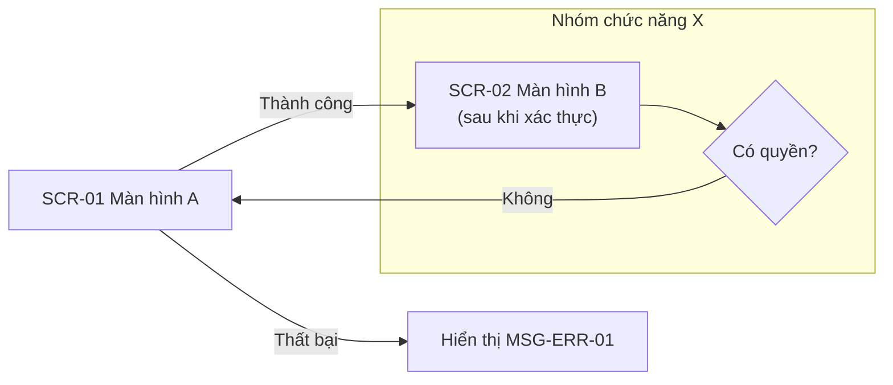
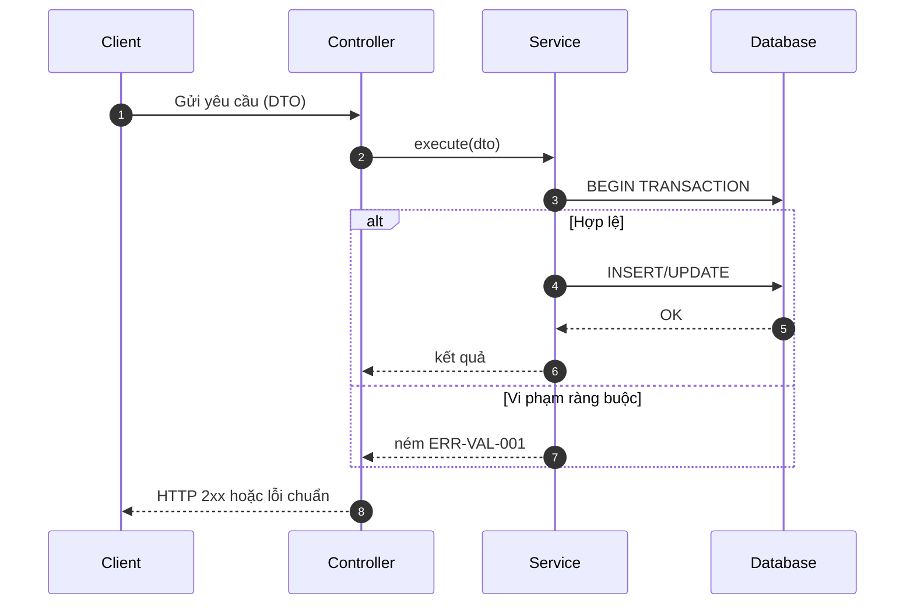
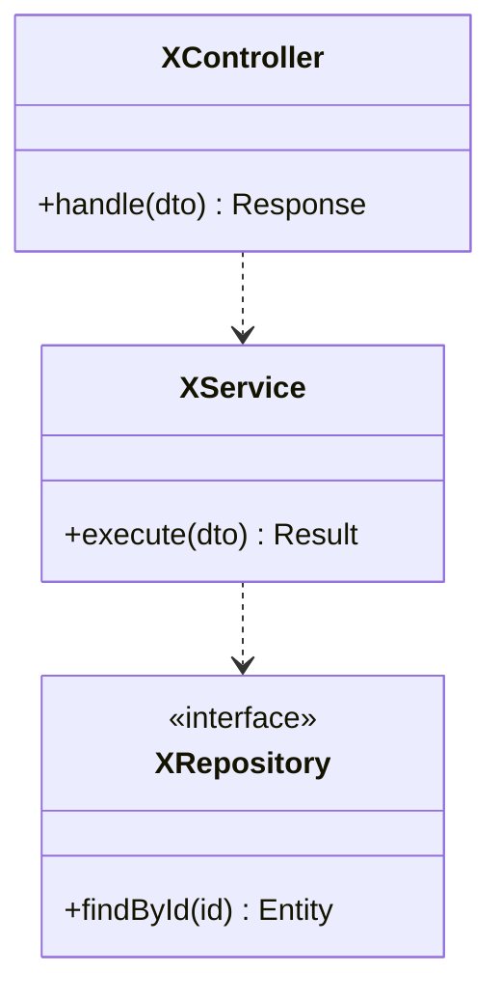
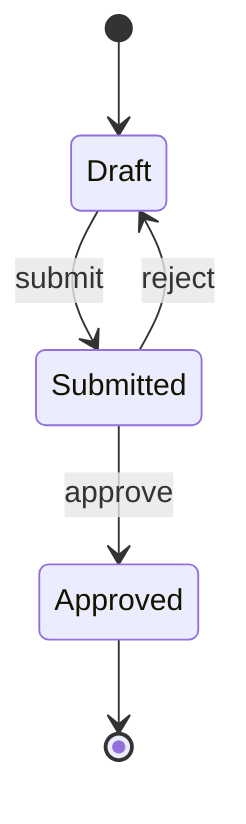

# Quy tắc Mermaid cho `*_Diagrams.md` (b2, b3) — theo từng loại sơ đồ

> Ví dụ dưới đây là KHUNG CÚ PHÁP minh họa với tên trung tính (A, B, SCR-01…). Nội dung thật lấy từ
> Functional Scope / Business Flows / Screen_List của dự án — không chép khung này vào deliverable.

## Quy tắc chung

- Nhãn viết theo ngôn ngữ của tài liệu chứa nó (`i18n-policy.md` quy tắc 4); tiếng Nhật/Việt dùng được trực tiếp, KHÔNG escape.
- Mỗi sơ đồ nằm trong một khối ```` ```mermaid ````, kèm tiêu đề `###` và 1–2 câu mô tả phía trên (khối mô tả nằm ngoài code fence).
- ID node: chữ-số-gạch dưới, không dấu cách (`scr01`, `chk_auth`); NHÃN mới là chỗ chứa chữ tiếng Việt/Nhật.
- Xuống dòng trong nhãn: dùng `<br/>` (cho phép). Cấm HTML khác (thẻ `<b>`, `<span>`, `<script>`…).
- Sơ đồ quá lớn (> ~25 node) → tách theo module; một sơ đồ tổng cho cả hệ thống + sơ đồ chi tiết từng nhóm màn hình.
- Sau khi viết: đọc lại từng sơ đồ theo checklist cuối file; nếu có `mmdc` thì render thử (`office-generation.md` §4) — lỗi cú pháp ở đây = sơ đồ trống khi khách mở.

## 1. flowchart (Screen Transition, Business Flow, Logic Flowchart)

Quy tắc: node có ngoặc `()[]{}`, dấu `:`/`;`/`#`/`"`, `/` hoặc chữ Nhật/Việt dài → BỌC NHÁY KÉP trong `[" "]`. Nhãn cạnh viết `-->|"điều kiện"|`. Mỗi `subgraph` có `end`.



- Quyết định dùng `{"…"}`; điểm bắt đầu/kết thúc dùng `(["…"])`.
- Dấu `"` bên trong nhãn → thay bằng `#quot;`.

## 2. sequenceDiagram (B3 — luồng gọi tuần tự)

Quy tắc: khai báo participant trước, alias không dấu cách; message text KHÔNG chứa `;` hay `#` trần (dùng `#59;` cho `;`); `alt/else/end`, `loop/end`, `opt/end`, `par/and/end` phải đóng đủ `end`. Nhãn participant có chữ có dấu: `participant ctl as Controller`, chữ Nhật/Việt đặt ở phần alias sau `as` (không dùng nháy kép).



## 3. classDiagram (B3 — class tổng thể)

Quy tắc: tên class là định danh (không dấu cách, không nháy); kiểu generic viết `List~Item~`; quan hệ `<|--` (kế thừa), `..>` (phụ thuộc), `-->` (liên kết), `*--` (composition). Nhóm theo tầng bằng `namespace` hoặc `note`. Tên tầng/class lấy từ `Class_List` — không gán tên framework (ORM, WebSocket…) nếu `tech_stack` không có.



## 4. stateDiagram-v2 (vòng đời trạng thái nếu có phê duyệt/trạng thái đơn)



Trạng thái có dấu cách/chữ Nhật: `state "Chờ duyệt" as pending`.

## 5. erDiagram — KHÔNG vẽ ở b2/b3

ERD thuộc `/a5-db-design` (`*_ERD.md`); b3 chỉ tham chiếu.

## Checklist soát lỗi (làm trước khi bàn giao)

| Lỗi hay gặp | Triệu chứng | Sửa |
|---|---|---|
| Node có `()` hoặc `:` không bọc nháy | lỗi "Parse error" | `id["Nhãn (chi tiết)"]` |
| Thiếu `end` | sơ đồ trống | đếm `subgraph/alt/loop/opt` = số `end` |
| `;` trong message sequence | cắt câu / lỗi | thay `#59;` hoặc bỏ |
| Nhãn cạnh có `|` | lỗi | bọc `-->|"a / b"|` |
| ID node trùng nhau | node bị gộp sai | đặt ID duy nhất |
| Dùng `graph` + `<b>` | HTML thô bị chặn | dùng `flowchart`, bỏ thẻ HTML |
| Sơ đồ quá rộng | chữ bé khi nhúng docx | đổi `LR`↔`TD`, tách nhỏ |
